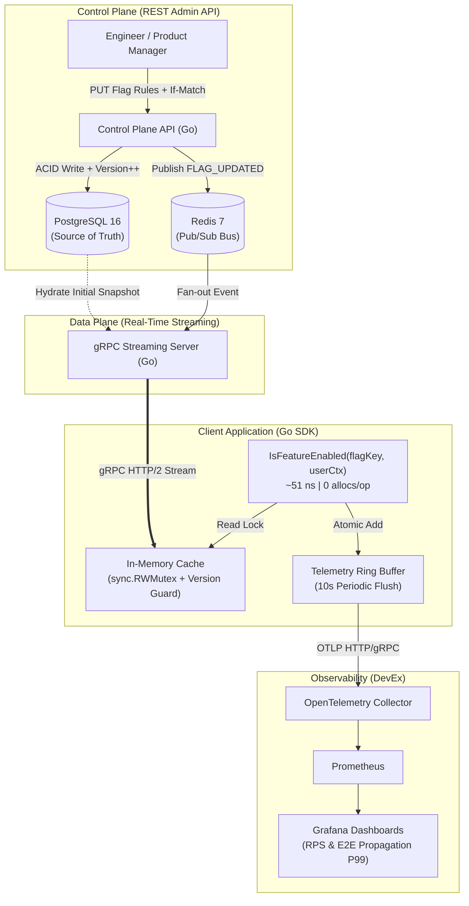

# Low-Latency Feature Flag Engine (Go)

An enterprise-grade, distributed **Feature Flag & Experimentation Engine** written in **Go**, engineered around strict separation between the **Control Plane** (rule management & persistence) and the **Data Plane** (real-time gRPC streaming & sub-microsecond local evaluation).

Designed with the same architectural principles used by systems like LaunchDarkly and Unleash at scale: **client applications never make network requests when evaluating a feature flag**.

---

## Key Engineering Highlights

- **Sub-Microsecond In-Memory Evaluation (`48.76 ns/op`, `0 allocs/op`):** Rules, regular expressions, and semver targets are pre-compiled on cache ingestion. Reads use a non-blocking `sync.RWMutex` read path with zero heap allocations.
- **Deterministic Rollouts via MurmurHash3 (`x86_32`):** Consistent percentage rollouts and A/B experiments (`0.01%` basis-point granularity) computed statelessly on stack-allocated buffers (`flagKey + ":" + userID + ":" + salt`).
- **Real-Time Cache Invalidation (`~0.52ms` E2E):** Control Plane updates in PostgreSQL publish `FLAG_UPDATED` events to **Redis Pub/Sub**, which horizontally scaled **gRPC Server Streaming** nodes push over persistent HTTP/2 tunnels to all connected SDKs in sub-milliseconds.
- **Race-Free Convergence & Resilience:**
  - Data Plane subscribes streams to the in-memory fan-out `Hub` *before* reading the PostgreSQL snapshot so in-flight mutations are never missed.
  - SDK enforces a **Monotonic Version Guard** (`incoming.Version > local.Version`) and reconnects with **Exponential Backoff + Full Jitter**, continuing to evaluate from local memory if the network or Control Plane is unreachable.
- **Non-Blocking OpenTelemetry SDK Buffer:** Flag evaluations increment lock-free atomic counters (`sync/atomic`) in memory and flush periodically every **10 seconds** over OTLP to the OpenTelemetry Collector, Prometheus, and Grafana.

---

## System Architecture



---

## Benchmarks

Executed on `go1.27 windows/amd64` (`12th Gen Intel Core i5-12400F`):

```text
$ go test -bench=. -benchmem ./internal/domain/flag ./pkg/sdk

goos: windows
goarch: amd64
pkg: github.com/danil/feature-flag-engine/internal/domain/flag
cpu: 12th Gen Intel(R) Core(TM) i5-12400F
BenchmarkCompiledFlag_Evaluate-12             	24356382	        48.76 ns/op	       0 B/op	       0 allocs/op

pkg: github.com/danil/feature-flag-engine/pkg/sdk
BenchmarkClient_IsFeatureEnabled_Parallel-12  	16042114	        71.61 ns/op	       0 B/op	       0 allocs/op
```

- **Domain Evaluator (`BenchmarkCompiledFlag_Evaluate`):** `48.76 ns/op` (~20.5M evaluations/sec/core), `0 B/op`, `0 allocs/op`.
- **Concurrent SDK Client (`BenchmarkClient_IsFeatureEnabled_Parallel`):** `71.61 ns/op` across 12 parallel worker threads including `sync.RWMutex` read locking and atomic OpenTelemetry counter recording, with `0 B/op` and `0 allocs/op`.

---

## Repository Structure (DDD & Clean Architecture)

```text
├── api/
│   ├── openapi/openapi.yaml          # OpenAPI 3.0 Control Plane specification
│   └── proto/v1/flagstream.proto     # gRPC Server Streaming contract
├── cmd/
│   ├── control-plane/main.go         # Admin REST API entrypoint
│   ├── data-plane/main.go            # gRPC Streaming Server entrypoint
│   └── demo-app/main.go              # Live traffic simulator for Grafana
├── internal/
│   ├── domain/                       # Pure business logic (Zero external dependencies)
│   │   ├── environment/              # Environment aggregate & repository port
│   │   └── flag/                     # Flag aggregate, MurmurHash3, Rule Evaluator
│   ├── application/                  # Use-case orchestration & optimistic locking
│   └── infrastructure/               # Adapters (PostgreSQL pgx, Redis Pub/Sub, gRPC Hub, HTTP, OTel)
├── pkg/
│   └── sdk/                          # Public Go SDK (In-memory cache, gRPC consumer, OTel buffer)
├── deployments/
│   ├── docker-compose.yml            # Full stack: Postgres, Redis, OTel, Prometheus, Grafana, Apps
│   ├── grafana/                      # Auto-provisioned Prometheus datasource & dashboards
│   └── terraform/                    # AWS IaC (VPC, ECS Fargate, RDS Postgres 16, ElastiCache Redis 7)
└── docs/
    └── adr/                          # Architecture Decision Records (ADRs 0001–0004)
```

---

## Quickstart

### 1. Run Unit Tests, E2E Streaming Tests & Benchmarks Locally (No Docker Required)

```bash
go test -v ./internal/... ./pkg/...
go test -bench=. -benchmem ./internal/domain/flag ./pkg/sdk
```

### 2. Launch Full Stack with Docker Compose

```bash
docker compose -f deployments/docker-compose.yml up --build -d
```

Services started:
- **Control Plane REST API:** `http://localhost:8080`
- **Data Plane gRPC Server:** `localhost:9090`
- **Grafana Dashboards:** `http://localhost:3000` (`admin` / `admin`)
- **Prometheus UI:** `http://localhost:9091`

### 3. Trigger a Real-Time Flag Update via REST API

Create or update the `new-checkout-flow` targeting rule in `production` (e.g., 100% rollout for Enterprise users in Malta `MT` and Brazil `BR`, and 30% default rollout for everyone else):

```bash
curl -X PUT http://localhost:8080/api/v1/environments/production/flags/new-checkout-flow \
  -H "Content-Type: application/json" \
  -d '{
    "enabled": true,
    "default_rollout_basis_points": 3000,
    "targeting_rules": [
      {
        "id": "rule-vip-markets",
        "name": "100% for Enterprise in Malta & Brazil",
        "clauses": [
          { "attribute": "country", "operator": "IN", "values": ["MT", "BR"] },
          { "attribute": "plan", "operator": "EQUALS", "values": ["enterprise"] }
        ],
        "rollout_basis_points": 10000
      }
    ]
  }'
```

All connected `demo-app` SDK instances receive the `FLAG_UPDATED` frame over gRPC and hot-swap their in-memory `CompiledFlag` in **< 10 milliseconds**.

---

## Go SDK Usage Example

```go
package main

import (
	"context"
	"fmt"
	"time"

	"github.com/danil/feature-flag-engine/pkg/sdk"
)

func main() {
	ctx := context.Background()

	client, err := sdk.NewClient(ctx, sdk.Config{
		DataPlaneAddress:   "localhost:9090",
		EnvironmentKey:     "production",
		SDKKey:             "sdk-prod-default-key",
		WaitForInitialSync: true,
		InitTimeout:        5 * time.Second,
		FlushInterval:      10 * time.Second,
	})
	if err != nil {
		panic(err)
	}
	defer client.Close()

	// Evaluated 100% in local memory (~75 nanoseconds, zero network I/O)
	enabled := client.IsFeatureEnabled("new-checkout-flow", sdk.EvaluationContext{
		UserID: "user-98412",
		Attributes: map[string]string{
			"country":     "MT",
			"plan":        "enterprise",
			"app_version": "2.5.0",
		},
	})

	fmt.Println("new-checkout-flow enabled:", enabled)
}
```

---

## Architecture Decision Records (ADRs)

- [ADR-0001: Physical and Logical Separation of Control Plane and Data Plane](docs/adr/0001-separate-control-and-data-plane.md)
- [ADR-0002: gRPC Server Streaming over WebSockets and HTTP Polling](docs/adr/0002-grpc-streaming-over-websockets-and-polling.md)
- [ADR-0003: Deterministic Percentage Rollouts via Stack-Allocated MurmurHash3](docs/adr/0003-murmurhash3-for-deterministic-rollouts.md)
- [ADR-0004: Redis Pub/Sub with Versioned Snapshot Fallback vs. Apache Kafka](docs/adr/0004-redis-pubsub-vs-kafka-for-cache-invalidation.md)

